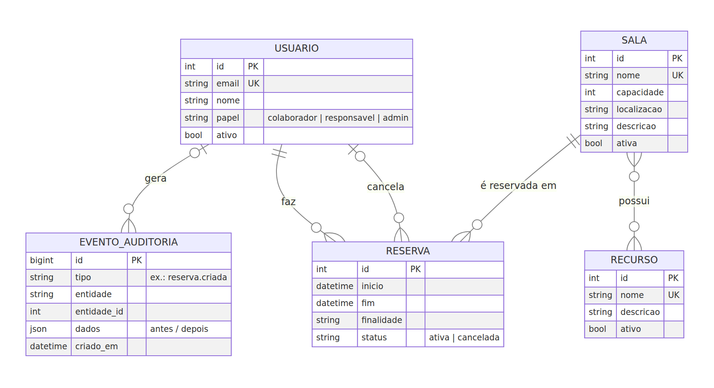
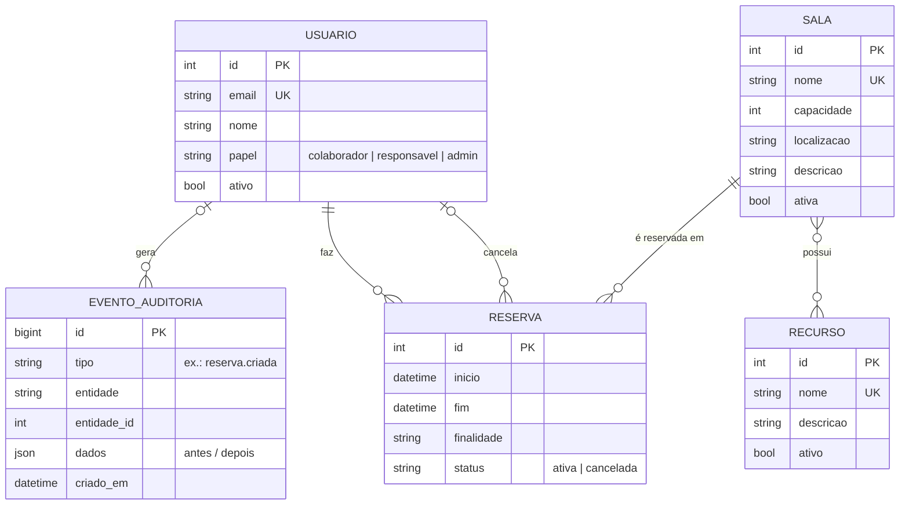
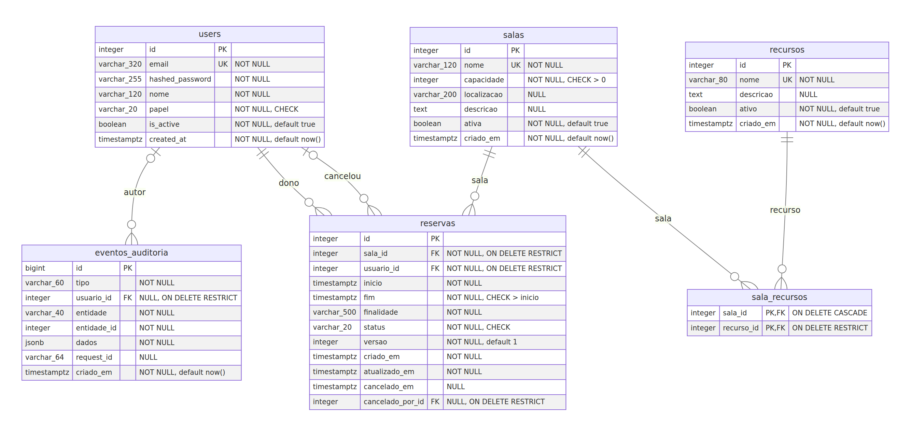
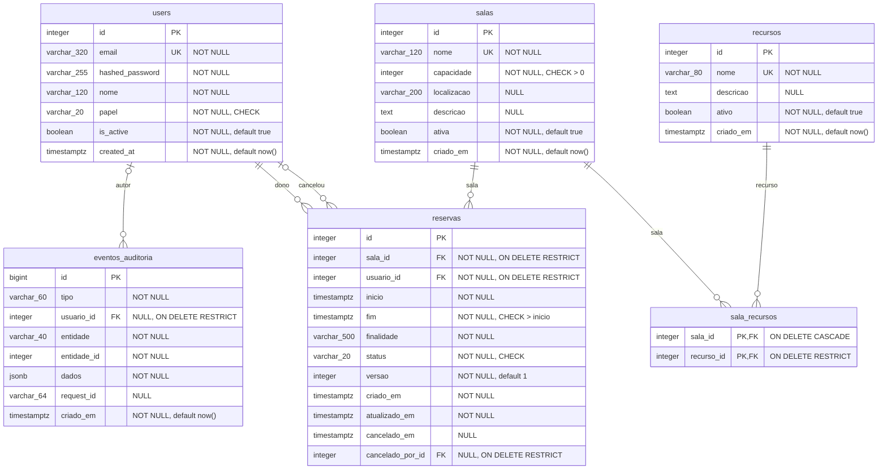

# Modelo de dados

Este documento descreve o banco de dados do sistema de reserva de salas em dois níveis:

1. **DER (modelo conceitual):** quais coisas o sistema guarda e como elas se relacionam, sem detalhes de banco.
2. **Modelo lógico:** as tabelas do PostgreSQL, com colunas, tipos, chaves e restrições.

> **Fonte da verdade:** as migrations em [`backend/alembic/versions/`](../backend/alembic/versions/). Este documento foi escrito a partir do banco criado por elas (`alembic upgrade head`). Se uma migration mudar o esquema, atualize este arquivo junto.

Os diagramas estão em [Mermaid](https://mermaid.js.org/) e o GitHub os desenha ao abrir a página. Versões em imagem: [`img/der.png`](img/der.png) e [`img/modelo-logico.png`](img/modelo-logico.png).

---

## 1. DER — modelo conceitual





### Entidades

| Entidade | O que representa |
| --- | --- |
| **Usuário** | Pessoa que usa o sistema. O **papel** define o que ela pode fazer: *colaborador* reserva salas, *responsável* também gerencia as reservas de todos, *admin* também cadastra salas, recursos e usuários. |
| **Sala** | Espaço físico que pode ser reservado, com capacidade e localização. |
| **Recurso** | Equipamento ou característica de uma sala: projetor, TV, videoconferência, ar-condicionado... |
| **Reserva** | Uso de uma sala por um usuário num intervalo de tempo, com uma finalidade. |
| **Evento de auditoria** | Registro imutável de cada alteração feita no sistema: quem fez, o quê, quando, e os dados antes e depois. |

### Relacionamentos e cardinalidades

| Relacionamento | Cardinalidade | Leitura |
| --- | --- | --- |
| Usuário **faz** Reserva | 1 : N | Um usuário faz zero ou várias reservas. Toda reserva tem exatamente um dono. |
| Usuário **cancela** Reserva | 1 : N (opcional) | Uma reserva cancelada guarda quem a cancelou: o próprio dono, um responsável ou um admin. Reserva ativa não tem esse vínculo. |
| Sala **é reservada em** Reserva | 1 : N | Uma sala tem zero ou várias reservas. Toda reserva é de exatamente uma sala. |
| Sala **possui** Recurso | N : N | Uma sala tem vários recursos e um recurso existe em várias salas. No modelo lógico vira a tabela associativa `sala_recursos`. |
| Usuário **gera** Evento de auditoria | 1 : N (opcional) | Cada evento aponta o usuário que fez a ação. Eventos sem usuário logado (ex.: carga inicial do seed) ficam sem autor. |

### Regras de negócio que o modelo garante

- **Sem reserva dupla:** a mesma sala não pode ter duas reservas **ativas** com horários que se sobrepõem. Reservas encostadas (10h–11h e 11h–12h) são permitidas.
- **Horário válido:** o fim da reserva é sempre depois do início.
- **Nada é apagado, só desativado:** salas, recursos e usuários têm um campo `ativo`/`ativa`, e o `DELETE` da API apenas desativa (soft delete). Uma reserva é **cancelada**, não apagada. Assim o histórico continua íntegro, e o banco garante isso com `ON DELETE RESTRICT` nas chaves estrangeiras.
- **Auditoria imutável:** eventos de auditoria só podem ser inseridos, nunca alterados ou apagados.

---

## 2. Modelo lógico (PostgreSQL)





Legenda: **PK** chave primária · **FK** chave estrangeira · **UK** valor único. `varchar_120` = `varchar(120)` (o Mermaid não aceita parênteses no tipo).

### Tabelas

#### `users`

| Coluna | Tipo | Nulo | Padrão | Observação |
| --- | --- | --- | --- | --- |
| `id` | `integer` | não | sequência | **PK** |
| `email` | `varchar(320)` | não | | **único** (`ix_users_email`), guardado em minúsculas |
| `hashed_password` | `varchar(255)` | não | | hash da senha (nunca a senha em texto) |
| `nome` | `varchar(120)` | não | | |
| `papel` | `varchar(20)` | não | `'colaborador'` | `CHECK` em `colaborador`, `responsavel`, `admin` |
| `is_active` | `boolean` | não | `true` | usuário desativado não consegue entrar |
| `created_at` | `timestamptz` | não | `now()` | |

> A tabela `users` e as colunas `is_active`/`created_at` mantêm os nomes em inglês da primeira versão do projeto. As tabelas criadas depois já usam português.

#### `salas`

| Coluna | Tipo | Nulo | Padrão | Observação |
| --- | --- | --- | --- | --- |
| `id` | `integer` | não | sequência | **PK** |
| `nome` | `varchar(120)` | não | | **único** (`uq_salas_nome`) |
| `capacidade` | `integer` | não | | `CHECK (capacidade > 0)` |
| `localizacao` | `varchar(200)` | sim | | |
| `descricao` | `text` | sim | | |
| `ativa` | `boolean` | não | `true` | sala desativada some do catálogo e não aceita reservas novas |
| `criado_em` | `timestamptz` | não | `now()` | |

#### `recursos`

| Coluna | Tipo | Nulo | Padrão | Observação |
| --- | --- | --- | --- | --- |
| `id` | `integer` | não | sequência | **PK** |
| `nome` | `varchar(80)` | não | | **único** (`uq_recursos_nome`) |
| `descricao` | `text` | sim | | |
| `ativo` | `boolean` | não | `true` | recurso desativado não é oferecido em salas novas |
| `criado_em` | `timestamptz` | não | `now()` | |

#### `sala_recursos` (tabela associativa da relação N:N)

| Coluna | Tipo | Nulo | Observação |
| --- | --- | --- | --- |
| `sala_id` | `integer` | não | **PK** e **FK** → `salas.id`, `ON DELETE CASCADE` |
| `recurso_id` | `integer` | não | **PK** e **FK** → `recursos.id`, `ON DELETE RESTRICT` |

- A PK composta `(sala_id, recurso_id)` impede ligar o mesmo recurso duas vezes à mesma sala.
- `CASCADE`: se uma sala for apagada, as ligações dela somem junto.
- `RESTRICT`: um recurso que está em alguma sala não pode ser apagado, só desativado.
- O índice `ix_sala_recursos_recurso_id` acelera o filtro do catálogo "salas que têm o recurso X".

#### `reservas`

| Coluna | Tipo | Nulo | Padrão | Observação |
| --- | --- | --- | --- | --- |
| `id` | `integer` | não | sequência | **PK** |
| `sala_id` | `integer` | não | | **FK** → `salas.id`, `ON DELETE RESTRICT` (índice `ix_reservas_sala_id`) |
| `usuario_id` | `integer` | não | | **FK** → `users.id`, `ON DELETE RESTRICT`, dono da reserva (índice `ix_reservas_usuario_id`) |
| `inicio` | `timestamptz` | não | | |
| `fim` | `timestamptz` | não | | `CHECK (fim > inicio)` |
| `finalidade` | `varchar(500)` | não | | |
| `status` | `varchar(20)` | não | `'ativa'` | `CHECK` em `ativa`, `cancelada` |
| `versao` | `integer` | não | `1` | `CHECK (versao >= 1)`, usado no *locking* otimista |
| `criado_em` | `timestamptz` | não | `now()` | |
| `atualizado_em` | `timestamptz` | não | `now()` | |
| `cancelado_em` | `timestamptz` | sim | | preenchido ao cancelar |
| `cancelado_por_id` | `integer` | sim | | **FK** → `users.id`, `ON DELETE RESTRICT`, quem cancelou |

**Constraint de exclusão (garantia contra reserva dupla):**

```sql
CONSTRAINT ex_reservas_sala_sem_sobreposicao
  EXCLUDE USING gist (
    sala_id WITH =,
    tstzrange(inicio, fim, '[)') WITH &&
  ) WHERE (status = 'ativa')
```

Ela diz: "não podem existir duas reservas **ativas** com a **mesma sala** (`=`) cujos intervalos se **sobrepõem** (`&&`)". O intervalo `[)` é semiaberto, então 10h–11h e 11h–12h não conflitam. Quem garante a regra é o próprio banco, mesmo com duas pessoas reservando ao mesmo tempo. Ela depende da extensão `btree_gist`, criada pela migration. Detalhes em [ADR-003](adr/ADR-003-concorrencia-e-tempo-real.md).

**Locking otimista:** toda alteração faz `UPDATE ... WHERE id = :id AND versao = :versao_lida` e soma 1 à versão. Se outra pessoa salvou antes, nenhuma linha é alterada e a API responde **409 Conflict**, em vez de sobrescrever a alteração do outro.

As três FKs de `reservas` são `ON DELETE RESTRICT`: o banco recusa apagar uma sala ou um usuário que tenha reservas. Salas e usuários são desativados, nunca apagados, e o histórico continua apontando para eles.

#### `eventos_auditoria`

| Coluna | Tipo | Nulo | Padrão | Observação |
| --- | --- | --- | --- | --- |
| `id` | `bigint` | não | sequência | **PK** |
| `tipo` | `varchar(60)` | não | | o fato ocorrido, ex.: `reserva.criada`, `sala.atualizada` |
| `usuario_id` | `integer` | sim | | **FK** → `users.id`, `ON DELETE RESTRICT`, quem fez a ação (nulo quando não há usuário logado) |
| `entidade` | `varchar(40)` | não | | tipo do registro afetado: `reserva`, `sala`, `recurso`, `usuario` |
| `entidade_id` | `integer` | não | | id do registro afetado |
| `dados` | `jsonb` | não | | `{"antes": {...}, "depois": {...}}` |
| `request_id` | `varchar(64)` | sim | | liga o evento ao log da requisição que o gerou |
| `criado_em` | `timestamptz` | não | `now()` | |

- `entidade` + `entidade_id` apontam para tabelas diferentes conforme o tipo do evento, por isso **não há FK** nesse par. O índice `ix_eventos_auditoria_entidade` atende à consulta "histórico deste registro".
- O gatilho `tg_eventos_auditoria_somente_insert` recusa qualquer `UPDATE` ou `DELETE`: a trilha de auditoria é *append-only*.
- O evento é gravado **na mesma transação** da alteração. Se uma falhar, as duas são desfeitas.

### Resumo das restrições

| Tipo | Nome | Tabela | Regra |
| --- | --- | --- | --- |
| UNIQUE | `ix_users_email` | `users` | e-mail único |
| UNIQUE | `uq_salas_nome` | `salas` | nome de sala único |
| UNIQUE | `uq_recursos_nome` | `recursos` | nome de recurso único |
| CHECK | `ck_users_papel` | `users` | papel válido |
| CHECK | `ck_salas_capacidade_positiva` | `salas` | capacidade > 0 |
| CHECK | `ck_reservas_fim_depois_do_inicio` | `reservas` | fim > início |
| CHECK | `ck_reservas_status` | `reservas` | status válido |
| CHECK | `ck_reservas_versao_positiva` | `reservas` | versão ≥ 1 |
| EXCLUDE | `ex_reservas_sala_sem_sobreposicao` | `reservas` | sem sobreposição de horário na mesma sala |
| TRIGGER | `tg_eventos_auditoria_somente_insert` | `eventos_auditoria` | proíbe UPDATE e DELETE |
| FK RESTRICT | `fk_reservas_sala_id_salas` | `reservas` | não apaga sala com reservas |
| FK RESTRICT | `fk_reservas_usuario_id_users`, `fk_reservas_cancelado_por_id_users` | `reservas` | não apaga usuário com reservas |
| FK RESTRICT | `fk_eventos_auditoria_usuario_id_users` | `eventos_auditoria` | não apaga autor de evento |
| FK RESTRICT | `fk_sala_recursos_recurso_id_recursos` | `sala_recursos` | não apaga recurso em uso |
| FK CASCADE | `fk_sala_recursos_sala_id_salas` | `sala_recursos` | apagar a sala apaga as ligações dela |

Toda chave estrangeira tem a ação de exclusão declarada. O teste `test_todas_as_chaves_estrangeiras_tem_acao_de_exclusao_definida` falha se alguma ficar sem.
